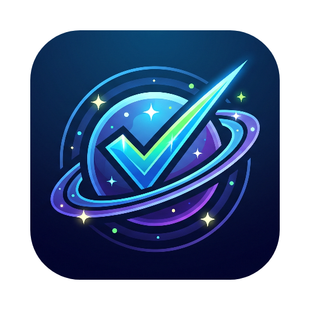

<div align="center">



# Cosmos — Productivity Hub

**Alışkanlık takibi, Trello tarzı proje panoları ve uzun vadeli analizler: hepsi uzay temalı tek bir masaüstü uygulamasında.**

[](https://github.com/11R5/cosmos-productivity-hub/actions/workflows/build.yml)
[](https://github.com/11R5/cosmos-productivity-hub/releases)


[İndir](https://github.com/11R5/cosmos-productivity-hub/releases) · [Kurulum](#-kurulum) · [Özellikler](#-özellikler) · [Kullanım Kılavuzu](docs/KULLANIM_KILAVUZU.md) · [Dokümanlar](#-dokümanlar) · [Kaynaktan derleme](#-kaynaktan-derleme) · [🇬🇧 English](README.md)


</div>

---

Cosmos, günlük rutinlerinle projelerini bir araya getirir. Alışkanlıklarını işaretleyebilir, işlerini Kanban panosunda planlayabilir ve bir yıllık geçmişine geri dönüp bakabilirsin. Hepsi tek bir pencerede.

- **Gizli.** Her şey kendi bilgisayarında saklanır. Hesap, sunucu veya veri toplama yok.
- **İnternetsiz.** Yazı tipleri, ikonlar, stiller ve grafikler uygulamanın içinde gelir. İnternet bağlantısı hiç gerekmez.
- **Çoklu platform.** Windows, macOS ve Linux sürümleri var.

## 📥 İndir

En güncel sürümü [**Releases sayfasından**](https://github.com/11R5/cosmos-productivity-hub/releases) indirebilirsin.

| Platform | Dosya | Açıklama |
|---|---|---|
| **Windows** | `Cosmos-x.y.z-setup.exe` | Başlat menüsü ve masaüstü kısayolu oluşturan kurulum dosyası |
| | `Cosmos-x.y.z-portable.exe` | Kurulum gerektirmez, USB bellekten bile çalışır |
| **macOS** | `Cosmos-x.y.z-mac-arm64.dmg` | Apple Silicon (M1/M2/M3/M4) |
| | `Cosmos-x.y.z-mac-x64.dmg` | Intel işlemcili Mac'ler |
| **Linux** | `Cosmos-x.y.z-linux-x86_64.AppImage` | Çoğu dağıtımda çalışır |
| | `Cosmos-x.y.z-linux-amd64.deb` | Debian / Ubuntu / Mint |

> **Dosyalar henüz dijital olarak imzalı değil.** Küçük açık kaynak projelerde bu normaldir, ancak ilk açılışta sistem bir uyarı gösterir. Aşağıdaki adımlarda bu uyarıyı nasıl geçeceğin anlatılıyor.

## 🧭 Kurulum

<details open>
<summary><b>🪟 Windows 10 / 11</b></summary>

**Kurulum dosyası (önerilen)**
1. [Releases](https://github.com/11R5/cosmos-productivity-hub/releases/latest) sayfasından `Cosmos-x.y.z-setup.exe` dosyasını indir.
2. Dosyaya çift tıkla. **"Windows bilgisayarınızı korudu"** (SmartScreen) uyarısı çıkarsa **Ek bilgi**'ye, ardından **Yine de çalıştır**'a tıkla.
3. Kurulum klasörünü seç ve **Yükle**'ye bas. Cosmos, Başlat menüsüne ve masaüstüne eklenir.

**Taşınabilir (kurulumsuz)**
1. `Cosmos-x.y.z-portable.exe` dosyasını indir ve istediğin yere koy (masaüstü, USB bellek…).
2. Çift tıklayıp çalıştır. SmartScreen bir kez yukarıdaki gibi sorabilir.

**Kaldırma:** Ayarlar → Uygulamalar → Cosmos → Kaldır. Verilerin `%APPDATA%\aliskanlik-takip-paneli` klasöründe kalır; tamamen silmek istersen o klasörü de sil.
</details>

<details>
<summary><b>🍎 macOS 11+ (Apple Silicon ve Intel)</b></summary>

1. Mac'ine uygun `.dmg` dosyasını indir:
   - Apple menüsü → **Bu Mac Hakkında**'ya bak. *Apple M1/M2/M3/M4* yazıyorsa `mac-arm64.dmg`, *Intel* yazıyorsa `mac-x64.dmg` dosyasını indir.
2. `.dmg`'yi aç ve **Cosmos**'u **Uygulamalar** klasörüne sürükle.
3. İlk açılışta Uygulamalar'daki Cosmos'a **sağ tıkla** → **Aç** → tekrar **Aç**.
4. *"Cosmos hasarlı ve açılamıyor"* uyarısı çıkarsa Terminal'i açıp aşağıdaki komutu çalıştır, sonra Cosmos'u normal şekilde aç:
   ```bash
   xattr -cr /Applications/Cosmos.app
   ```

**Kaldırma:** Cosmos'u Uygulamalar'dan Çöp Sepeti'ne sürükle. Verilerin `~/Library/Application Support/aliskanlik-takip-paneli` klasöründedir.
</details>

<details>
<summary><b>🐧 Linux (x64)</b></summary>

**Debian / Ubuntu / Mint (.deb)**
```bash
sudo apt install ./Cosmos-x.y.z-linux-amd64.deb
```
Sonra uygulama menüsünden **Cosmos**'u aç. Kaldırmak için `sudo apt remove aliskanlik-takip-paneli` komutunu çalıştır.

**Tüm dağıtımlar (AppImage)**
```bash
chmod +x Cosmos-x.y.z-linux-x86_64.AppImage
./Cosmos-x.y.z-linux-x86_64.AppImage
```
Ubuntu 22.04 ve sonrasında açılmazsa `sudo apt install libfuse2` komutuyla FUSE 2'yi kur.

Verilerin `~/.config/aliskanlik-takip-paneli` klasöründedir.
</details>

**Güncelleme:** Yeni sürümü indirip eskisinin üzerine kur (veya taşınabilir dosyayı değiştir). Verilerin olduğu yerde kalır.

## ✨ Özellikler

### 🔁 Alışkanlık Takibi

| | |
|---|---|
| **Haftalık işaretleme tablosu** | Her alışkanlığı her gün için tek tıkla işaretleyebilirsin. Bugünün sütunu vurgulanır. |
| **Alışkanlığa özel gün planı** | Her alışkanlığın haftanın hangi günleri tekrar edeceğini seçebilirsin (ör. *Pzt, Çar, Cum*). *Her Gün*, *Hafta İçi* ve *Hafta Sonu* kısayolları var. Plan dışı günler soluk görünür. |
| **Akıllı seri (streak)** | Plan dışı günler seriyi bozmaz. Bugünü henüz işaretlemediysen gün bitmeden serin sıfırlanmaz. |
| **Zaman yolculuğu** | `‹` / `›` oklarıyla geçmiş veya gelecek haftalara gidip unuttuğun günleri işaretleyebilirsin. **Bugüne Dön** seni içinde bulunduğun haftaya geri getirir. |
| **Özet kartlar** | Bugünkü ilerleme, haftalık başarı oranı, en güçlü aktif seri ve Kanban özeti. |
| **Seri liderliği** | Alışkanlıklar güncel serilerine göre 🔥 rozetleriyle sıralanır. Her birinin toplam kaç gün tamamlandığı da görünür. |
| **3D haftalık grafik** | Seçili haftanın günlük tamamlama oranını 3D sütun veya neon dalga olarak gösterir. |
| **Kategoriler ve filtre** | Kategori ekleyip silebilir, tabloyu kategoriye göre süzebilirsin. |
| **Sınırsız renk** | Neon paletten veya renk seçiciden seçebilir ya da doğrudan `#RRGGBB` HEX kodu yazabilirsin. |


### 📋 Projeler & Kanban


| | |
|---|---|
| **Birden fazla proje** | Her projenin kendi rengi ve kendi panosu var. Sekmelerde her projenin kart sayısı görünür. |
| **Üç sütun** | **TODO → IN PROGRESS → DONE**. Kartları sürükle-bırak ile veya kart üzerindeki hızlı butonlarla taşıyabilirsin. |
| **Proje istatistikleri** | Tamamlanma yüzdesi, süren işler ve projedeki tüm alt görevlerin ilerlemesi. |
| **Zengin kartlar** | Her kartta başlık, notlar, kapak rengi ve istediğin kadar renkli etiket olabilir. |
| **İsteğe bağlı alt liste** | Herhangi bir karta alt görevler ekleyip onları doğrudan pano üzerinde işaretleyebilirsin. İlerleme çubuğu anında güncellenir (ör. `2/4 · %50`). |


### 📊 Raporlar & Analiz


| | |
|---|---|
| **Ay seçici** | İstediğin geçmiş ayı inceleyebilirsin. |
| **Günlük disiplin eğrisi** | Seçili ayın her günü için tamamlama oranı. |
| **Kategori dengesi radarı** | Hayatının hangi alanlarına daha çok emek verdiğini gösterir. |
| **Kanban raporu** | Tüm projelerdeki TODO / IN PROGRESS / DONE kart sayıları, yığılmış grafik olarak. |
| **Aylık karne** | Her alışkanlık için planlanan ve tamamlanan gün sayısı. |
| **Yıllık aktivite ısı haritası** | Son 52 haftayı (364 gün) gösteren GitHub tarzı tablo. |

### 💾 Veri & Yedekleme

- Her değişiklik anında otomatik kaydedilir. Bilgisayarı yeniden başlattığında veya uygulamayı güncellediğinde verilerin kaybolmaz.
- **Yedek İndir** her şeyi okunabilir bir `cosmos_yedek_YYYY-MM-DD.json` dosyasına aktarır.
- **Yedek Yükle** bir yedeği geri yükler. Böylece verilerini yeni bir bilgisayara taşıyabilirsin. v1 yedekleri de kabul edilir.

| İşletim sistemi | Veri klasörü |
|---|---|
| Windows | `%APPDATA%\aliskanlik-takip-paneli\` |
| macOS | `~/Library/Application Support/aliskanlik-takip-paneli/` |
| Linux | `~/.config/aliskanlik-takip-paneli/` |

## 🛠️ Teknolojiler

| Katman | Teknoloji |
|---|---|
| Masaüstü çatısı | Electron 30 |
| Paketleme | electron-builder (NSIS, portable, DMG, AppImage, deb) |
| Arayüz | HTML5 + Vanilla JavaScript, `src/index.html` içinde tek sayfalık uygulama |
| Stil | Tailwind CSS 3 (yerelde derlenir), cam (glassmorphism) ve 3D perspektif için özel CSS |
| Grafikler | Chart.js 4 + özel 3D gölge eklentisi |
| İkonlar | Lucide |
| Yazı tipleri | Inter ve Space Grotesk (Fontsource ile uygulamaya dahil) |
| Arka plan | HTML5 Canvas yıldız animasyonu |
| Veri | `localStorage` (diskte Chromium LevelDB) |
| CI/CD | GitHub Actions üç platformu derler ve sürüm yayınlar |

## 🧑‍💻 Kaynaktan derleme

[Node.js](https://nodejs.org/) 20 veya üzeri gerekir.

```bash
git clone https://github.com/11R5/cosmos-productivity-hub.git
cd cosmos-productivity-hub
npm install
npm start
```

| Komut | Ne yapar |
|---|---|
| `npm start` | Uygulamayı geliştirme modunda açar |
| `npm test` | Uçtan uca duman testini çalıştırır (gerçek klavye girişiyle 34 kontrol) |
| `npm run build:win` | Windows kurulum dosyasını ve taşınabilir `.exe`'yi `dist/` klasörüne üretir |
| `npm run build:mac` | Intel ve Apple Silicon için `.dmg` üretir (macOS'ta çalıştırılmalı) |
| `npm run build:linux` | `.AppImage` ve `.deb` üretir (Linux'ta çalıştırılmalı) |
| `npm run build:css` | `src/index.html` içinde sınıf değiştirdikten sonra Tailwind'i yeniden derler |
| `npm run vendor` | Chart.js, Lucide ve fontları `node_modules`'dan `src/vendor/`'a kopyalar |
| `npm run icon` | `Logo/Logo.jpg`'den PNG uygulama ikonlarını yeniden üretir |
| `npm run screenshots` | Demo veriyle `docs/screenshots/` görsellerini yeniden üretir (gerçek verine dokunmaz) |

> **Windows ipucu:** Derleme sırasında `Cannot create symbolic link` hatası alırsan terminali Yönetici olarak aç veya **Geliştirici Modu**'nu aç (Ayarlar → Sistem → Geliştiriciler için).

### Yeni sürüm yayınlama

1. `package.json` içindeki `version` alanını artır.
2. `CHANGELOG.md`'ye yeni sürümün notunu ekle.
3. Bir sürüm etiketi gönder:

```bash
git tag vX.Y.Z
git push origin vX.Y.Z
```

GitHub Actions testleri çalıştırır, Windows, macOS ve Linux sürümlerini derler ve dosyaları yeni bir GitHub Release'e ekler.

## 📚 Dokümanlar

| Belge | İçerik |
|---|---|
| [Kullanım Kılavuzu](docs/KULLANIM_KILAVUZU.md) | Her ekranın adım adım kullanımı |
| [Proje Planı](docs/PROJE_PLANI.md) | Vizyon, kapsam, yol haritası, dağıtım, riskler |
| [Teknik Doküman](docs/TEKNIK_DOKUMAN.md) | Mimari, veri modeli, çizim döngüsü, güvenlik, derleme, testler |
| [İş Akışları](docs/IS_AKISLARI.md) | Kullanıcı, geliştirme, sürüm yayınlama ve hata takibi akışları (diyagramlı) |
| [Bilinen Sorunlar](docs/BILINEN_SORUNLAR.md) | Hata kaydı: düzeltilenler ve açık olanlar |
| [Değişiklik Günlüğü](CHANGELOG.md) | Her sürümde neler değişti (İngilizce) |
| [User Guide](docs/USER_GUIDE.md) | İngilizce kullanım kılavuzu |

## 🗺️ Yol Haritası

- [x] Windows, macOS ve Linux sürümleri
- [x] Tamamen internetsiz çalışma
- [x] Uygulama ikonu
- [x] GitHub Actions ile otomatik sürüm yayınlama
- [x] CI'da uçtan uca duman testi
- [ ] Desteklenen bir Electron sürümüne geçiş
- [ ] Dosya tabanlı veri ve otomatik yedekleme
- [ ] İngilizce dil desteği
- [ ] Hatırlatıcılar ve bildirimler
- [ ] Otomatik güncelleme
- [ ] Windows ve macOS için dijital imza

Ayrıntılar [Proje Planı](docs/PROJE_PLANI.md)'nda. Bir fikrin mi var? [Issue aç](https://github.com/11R5/cosmos-productivity-hub/issues).

## 🤝 Katkıda bulunma

1. Repoyu fork'la ve yeni bir dal aç.
2. Değişikliğini `src/index.html` içinde yap. Ardından `npm run build:css` çalıştır ve `npm start` ile dene.
3. `npm test` çalıştır; tüm kontroller geçmeli.
4. Veri şemasını **geriye uyumlu** tut; mevcut kullanıcıların verileri yüklenmeye devam etmeli.
5. Kısa bir açıklama ve mümkünse ekran görüntüsüyle Pull Request aç.

Tam kontrol listesi için [İş Akışları](docs/IS_AKISLARI.md) belgesine bak.

## 📄 Lisans

[Apache License 2.0](LICENSE). Uygulamaya dahil edilen üçüncü parti kütüphaneler kendi lisanslarına (MIT / ISC / OFL) tabidir.
