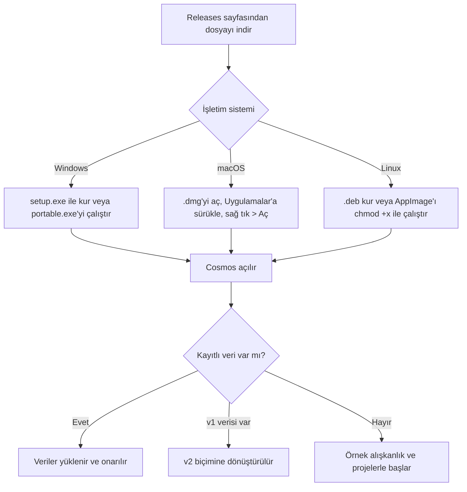
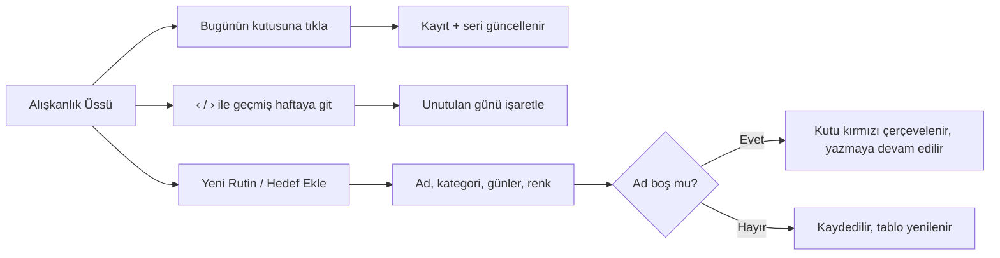
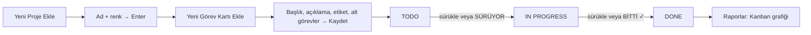
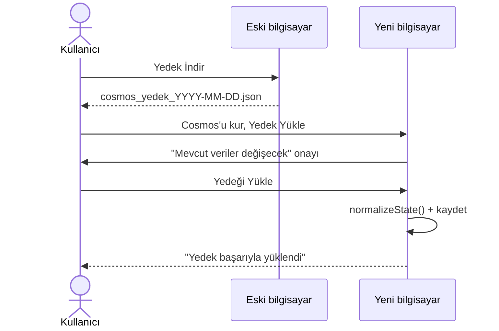
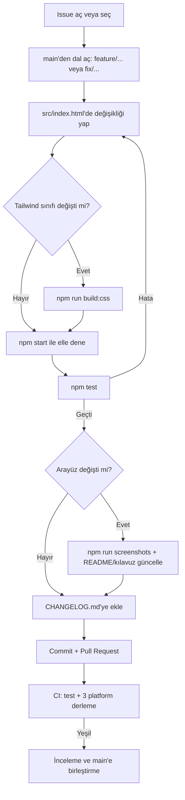
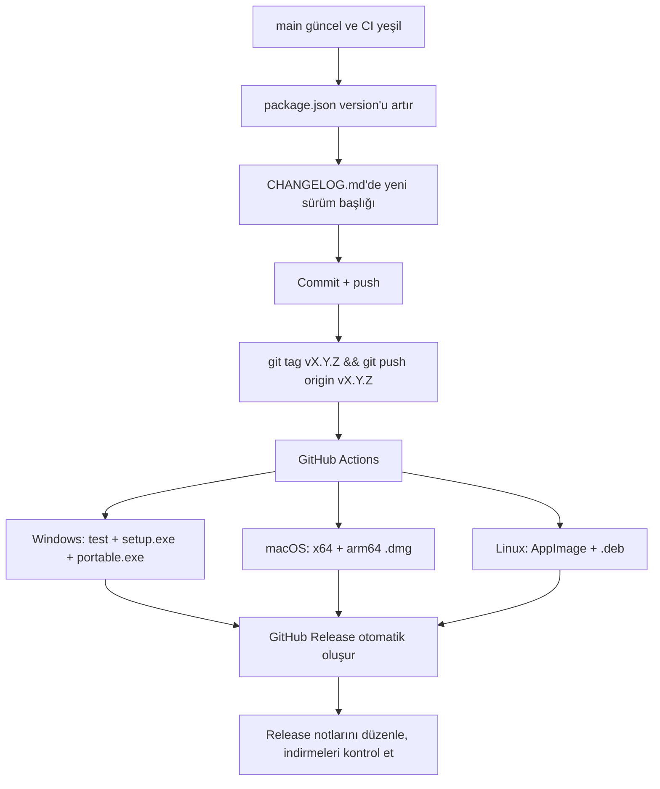
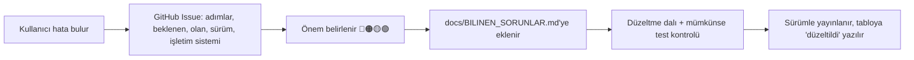

# Cosmos — İş Akışları

Bu belge, kullanıcı akışlarını ve projeyi geliştirme, test ve yayınlama süreçlerini anlatır.

> İlgili belgeler: [Proje Planı](PROJE_PLANI.md) · [Teknik Doküman](TEKNIK_DOKUMAN.md) · [Bilinen Sorunlar](BILINEN_SORUNLAR.md)

---

## A. Kullanıcı akışları

### A1. İlk kurulum ve açılış



### A2. Günlük alışkanlık takibi



### A3. Proje ve görev yönetimi (Kanban)



Kartı silmek: kartın düzenle ikonu → **Kartı Sil** → onay.

### A4. Yedekleme ve taşıma



---

## B. Geliştirme akışı

### B1. Ortamı hazırlama

```bash
git clone https://github.com/11R5/cosmos-productivity-hub.git
cd cosmos-productivity-hub
npm install
npm start
```

### B2. Bir değişiklik yapma



Commit mesajı kuralı: kısa ve emir kipinde bir başlık (ör. `Fix category delete with apostrophe`), gerekirse altına madde madde açıklama.

### B3. Kontrol listesi (PR öncesi)

- [ ] `npm test` geçiyor
- [ ] `npm start` ile ilgili ekran elle denendi
- [ ] Kullanıcı metni `innerHTML`'e yazılıyorsa `esc()` kullanıldı
- [ ] `alert`, `confirm` veya `prompt` kullanılmadı
- [ ] Şema değiştiyse `normalizeState()` güncellendi ve eski verilerle denendi
- [ ] Gerekiyorsa `src/vendor/tailwind.css` yeniden derlendi
- [ ] CHANGELOG ve ilgili dokümanlar güncellendi

---

## C. Sürüm yayınlama akışı



Sürüm numarası ([SemVer](https://semver.org/)):
- **Yama (`2.1.1`):** hata düzeltmesi
- **Küçük (`2.2.0`):** geriye uyumlu yeni özellik
- **Büyük (`3.0.0`):** veri biçimini veya kullanımı bozan değişiklik

---

## D. Hata bildirimi ve takip akışı


