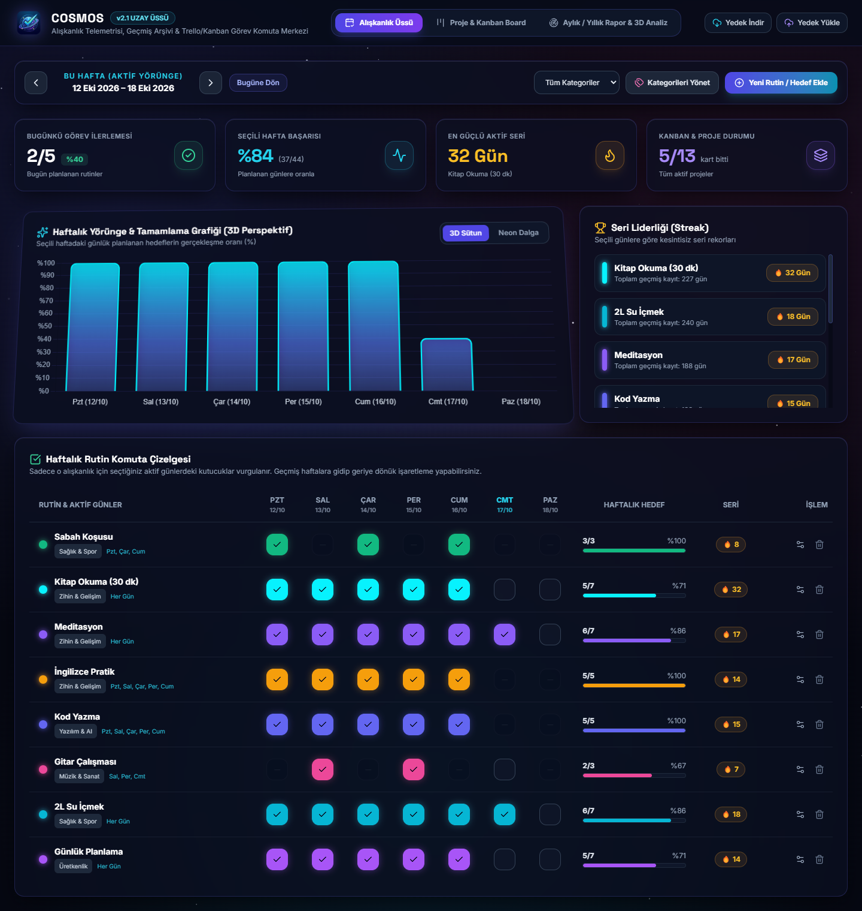
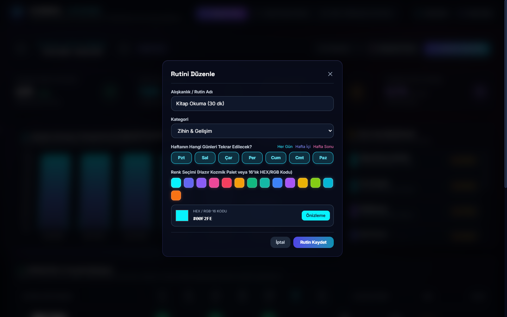
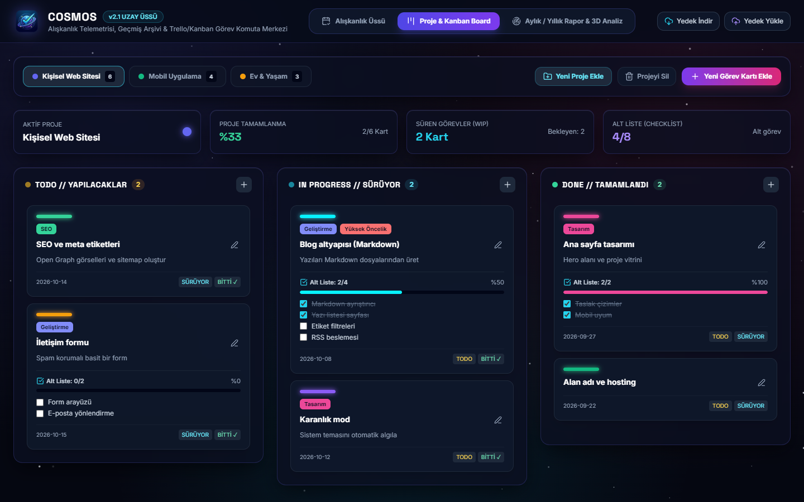
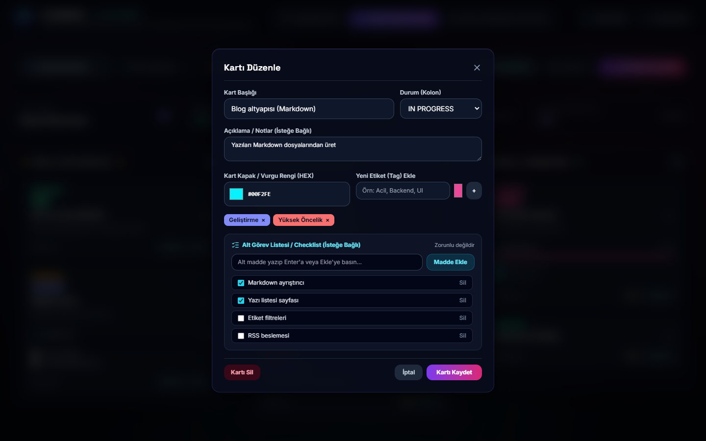
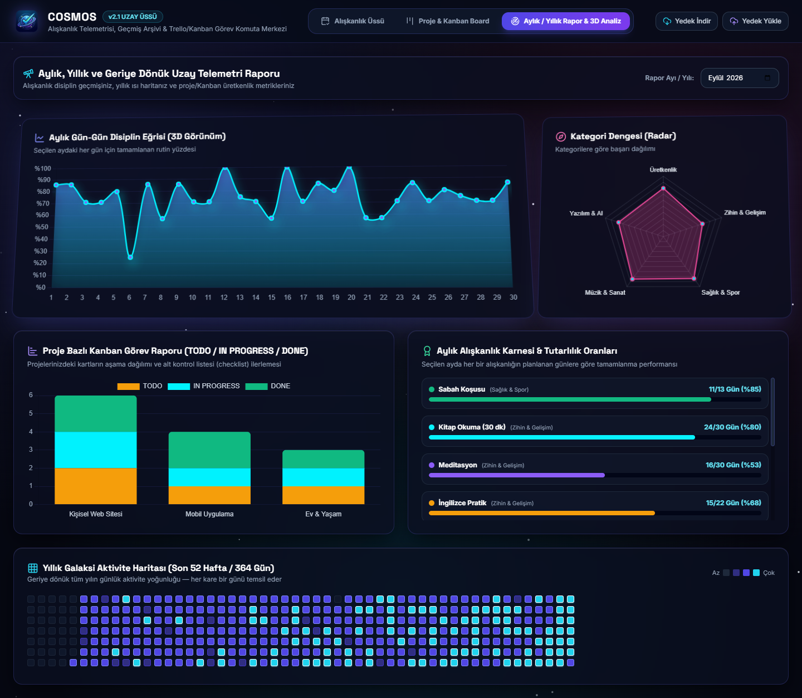

# Cosmos — Kullanım Kılavuzu

Bu kılavuz Cosmos'u ilk kez kullananlar için hazırlandı. 5 dakikada temel kullanımı öğrenebilirsin.

> 🇬🇧 [English User Guide](USER_GUIDE.md) · ⬅️ [README'ye dön](../README.tr.md)

## İçindekiler

1. [Kurulum](#1-kurulum)
2. [Ekranın genel yapısı](#2-ekranın-genel-yapısı)
3. [Alışkanlık Üssü](#3-alışkanlık-üssü)
4. [Proje & Kanban](#4-proje--kanban)
5. [Raporlar](#5-raporlar)
6. [Yedekleme ve taşıma](#6-yedekleme-ve-taşıma)
7. [Sık sorulan sorular](#7-sık-sorulan-sorular)

---

## 1. Kurulum

[Releases](https://github.com/11R5/cosmos-productivity-hub/releases) sayfasından işletim sistemine uygun dosyayı indir:

- **Windows:** Kurmak için `Cosmos-…-setup.exe`, kurmadan kullanmak için `Cosmos-…-portable.exe`.
  - SmartScreen uyarısı çıkarsa **Ek bilgi** → **Yine de çalıştır**'a tıkla.
- **macOS:** `.dmg` dosyasını aç ve Cosmos'u **Uygulamalar** klasörüne sürükle.
  - İlk açılışta uygulamaya sağ tık → **Aç** de.
  - "Hasarlı" uyarısı alırsan Terminal'de `xattr -cr /Applications/Cosmos.app` komutunu çalıştır.
- **Linux:** `.deb` dosyasını paket yöneticinle kur. AppImage kullanacaksan önce `chmod +x Cosmos-*.AppImage` komutunu çalıştır, sonra dosyayı aç.

İlk açılışta örnek alışkanlıklar ve projeler gelir. Bunları inceleyip silebilir veya düzenleyebilirsin.

## 2. Ekranın genel yapısı

Üst çubukta üç ana sekme ve yedekleme butonları bulunur:

| Bölüm | Ne işe yarar |
|---|---|
| **Alışkanlık Üssü** | Günlük rutinleri işaretlediğin haftalık tablo |
| **Proje & Kanban Board** | Projeler ve TODO / IN PROGRESS / DONE panosu |
| **Aylık / Yıllık Rapor & 3D Analiz** | Geçmişe dönük grafikler ve ısı haritası |
| **Yedek İndir / Yedek Yükle** | Tüm verini `.json` dosyası olarak alıp geri yükleme |

> 💡 **İpucu:** Açılan pencerelerde imleç ilk kutuda hazır bekler. **Enter** kaydeder, **Esc** pencereyi kapatır.

## 3. Alışkanlık Üssü

### Yeni alışkanlık ekleme
1. Sağ üstteki **Yeni Rutin / Hedef Ekle** butonuna tıkla.
2. Bir **ad** yaz ve bir **kategori** seç.
3. **Haftanın hangi günleri** tekrar edeceğini seç.
   - Günlere tek tek tıklayabilir veya *Her Gün*, *Hafta İçi*, *Hafta Sonu* kısayollarını kullanabilirsin.
4. Bir **renk** seç: paletten tıklayabilir, renk kutusunu kullanabilir veya `#FF5733` gibi bir HEX kodu yazabilirsin.
5. **Rutin Kaydet**'e bas.

### Günü işaretleme
- Tabloda alışkanlığın satırında ilgili günün kutusuna tıkla. Tekrar tıklarsan işaret kalkar.
- Plan dışı günler soluk görünür. İstersen onları da işaretleyebilirsin; işaretlemezsen serin bozulmaz.

### Geçmiş haftalara gitme
- Üstteki `‹` ve `›` oklarıyla haftalar arasında gezin. Unuttuğun günleri geriye dönük işaretleyebilirsin.
- **Bugüne Dön** seni içinde bulunduğun haftaya getirir.

### Düzenleme ve silme
- Satırın sağındaki **İşlem** sütununda **Düzenle** (ayar ikonu) ve **Sil** (çöp kutusu) butonları var.

### Kategoriler
- **Kategorileri Yönet** ile yeni kategori ekleyebilir veya mevcut kategorileri silebilirsin.
- Yanındaki açılır menüden tabloyu tek bir kategoriye göre süzebilirsin.

### Seri (streak) nasıl hesaplanır?
- Seri, planlanan günlerde art arda kaç kez tamamladığını gösterir.
- Plan dışı günler sayılmaz ve seriyi bozmaz.
- Bugünü henüz işaretlemediysen dünkü serin korunur. Gün bitmeden telaş yok!

## 4. Proje & Kanban

### Proje oluşturma
1. **Yeni Proje Ekle**'ye tıkla, bir ad ve renk ver, **Oluştur**'a bas.
2. Üstteki proje sekmeleriyle projeler arasında geçiş yap.
3. **Projeyi Sil** seçili projeyi ve içindeki tüm kartları siler.

### Kart ekleme
- **Yeni Görev Kartı Ekle**'ye veya bir sütunun başlığındaki **+** butonuna tıkla.
- Kartta şunlar olabilir:
  - **Başlık** ve **açıklama**
  - **Durum** (sütun)
  - **Kapak rengi**
  - **Etiketler:** etiket adını yaz, rengini seç ve **+**'ya bas.
  - **Alt görev listesi** (isteğe bağlı): maddeyi yaz, **Enter**'a veya **Madde Ekle**'ye bas.
- **Kartı Kaydet** ile kaydet.

### Kartları taşıma
- Kartı sürükleyip başka bir sütuna bırakabilirsin.
- Ya da kartın altındaki **TODO**, **SÜRÜYOR**, **BİTTİ ✓** butonlarını kullanabilirsin.
- Alt görevleri doğrudan kartın üzerinden işaretleyebilirsin. İlerleme çubuğu anında güncellenir.

## 5. Raporlar

- Sağ üstteki **Rapor Ayı / Yılı** alanından incelemek istediğin ayı seç.
- **Disiplin eğrisi:** Ayın her günü için rutinlerinin yüzde kaçını tamamladığını gösterir.
- **Kategori radarı:** Hangi alanlarda daha istikrarlı olduğunu gösterir.
- **Kanban raporu:** Her projedeki kartların aşamalara göre dağılımını gösterir.
- **Aylık karne:** Her alışkanlık için "tamamlanan / planlanan gün" sayısını gösterir.
- **Yıllık ısı haritası:** Son 364 günü gösterir. Renk ne kadar parlaksa o gün o kadar aktiftin.

## 6. Yedekleme ve taşıma

- Verilerin her değişiklikte otomatik kaydedilir. Ayrıca bir şey yapmana gerek yok.
- Güvenlik için arada bir **Yedek İndir**'e bas. `cosmos_yedek_YYYY-MM-DD.json` adında bir dosya iner.
- Verilerini yeni bir bilgisayara taşımak için:
  1. Eski bilgisayarda **Yedek İndir**'e bas.
  2. Yeni bilgisayarda Cosmos'u kur.
  3. **Yedek Yükle** ile indirdiğin dosyayı seç.

> ⚠️ **Yedek Yükle** mevcut verilerin **yerine** geçer. Yüklemeden önce mevcut verini de yedeklemen iyi olur.

Verilerin şu klasörde durur:

| Sistem | Klasör |
|---|---|
| Windows | `%APPDATA%\aliskanlik-takip-paneli\` |
| macOS | `~/Library/Application Support/aliskanlik-takip-paneli/` |
| Linux | `~/.config/aliskanlik-takip-paneli/` |

## 7. Sık sorulan sorular

**Uygulamayı kapatınca veya bilgisayarı yeniden başlatınca verilerim gider mi?**
Hayır. Veriler diskte saklanır. Yalnızca yukarıdaki veri klasörünü silersen kaybolur.

**İnternet bağlantısı gerekiyor mu?**
Hayır. Cosmos tamamen çevrimdışı çalışır ve hiçbir yere veri göndermez.

**Yeni sürüme geçince verilerim kalır mı?**
Evet. Yeni sürümü kurduğunda (veya yeni portable `.exe`'yi açtığında) aynı veri klasörünü kullanır.

**Telefonda kullanabilir miyim?**
Şimdilik hayır. Cosmos bir masaüstü uygulaması.

**Bir hata buldum veya bir fikrim var.**
[GitHub Issues](https://github.com/11R5/cosmos-productivity-hub/issues) üzerinden bize yazabilirsin.
