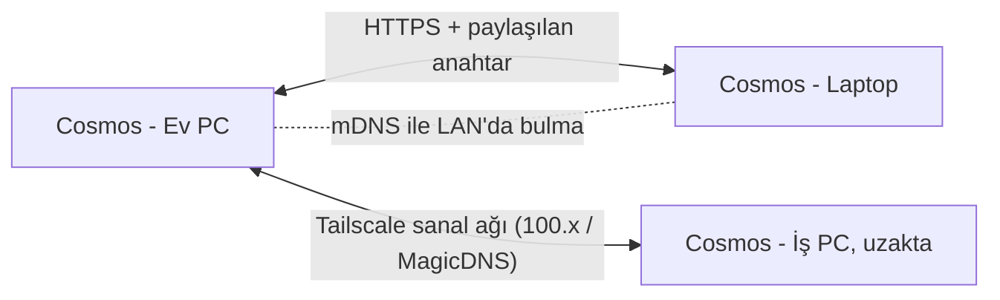

# Cosmos — Ücretsiz Senkronizasyon İş Planı

> **Durum:** Planlama aşamasında (taslak). Henüz kodlanmadı.
> İlgili belgeler: [Proje Planı](PROJE_PLANI.md) · [Teknik Doküman](TEKNIK_DOKUMAN.md) · [Bilinen Sorunlar](BILINEN_SORUNLAR.md)

## 1. Amaç

Kullanıcı Cosmos'u **birden fazla bilgisayarda** (ör. ev PC'si, iş laptopu, Mac) kullanabilmeli ve verileri bu cihazlar arasında **otomatik olarak eşitlenmeli**.

Koşullar:
- **Ücretsiz:** Cosmos tarafında sunucu, abonelik veya hesap olmayacak.
- **Gizlilik korunur:** Veri ya kullanıcının kendi cihazlarında ya da kullanıcının kendi bulut hesabında (ör. Google Drive) durur.
- **İsteğe bağlı:** Senkronizasyonu açmayan kullanıcı için hiçbir şey değişmez; uygulama tamamen çevrimdışı çalışmaya devam eder.
- **Veri kaybı yok:** Çakışmalar güvenli şekilde birleştirilir. Her senkronizasyondan önce yerel yedek alınır.

## 2. Seçenekler

| # | Yöntem | Kullanıcıya maliyeti | Kurulum zorluğu | İnternet gerekir mi? | Gizlilik | Geliştirme eforu |
|---|---|---|---|---|---|---|
| **A** | **Senkron klasörü:** veri dosyası Google Drive for Desktop / OneDrive / Dropbox / iCloud Drive klasöründe tutulur | Ücretsiz (bulutun ücretsiz kotası) | Kolay: klasör seçmek yeterli | Bulut için evet | Kullanıcının kendi bulutu | **Düşük** |
| **B** | **Syncthing** (açık kaynak P2P klasör eşitleme) + A'daki klasör yapısı | Ücretsiz | Orta: Syncthing'i kurmak gerekir | Hayır (LAN'da), uzakta evet | Bulut yok, cihazdan cihaza | Düşük (A ile aynı kod) |
| **C** | **Google Drive API:** Cosmos, Drive'daki gizli uygulama klasörüne doğrudan yazar | Ücretsiz (15 GB Google kotası) | Kolay: "Google ile bağlan" butonu | Evet | Kullanıcının Google hesabı | **Orta** |
| **D** | **Yerel ağ / Tailscale P2P:** Cosmos'lar birbirine doğrudan bağlanır (LAN'da otomatik bulma; uzaktaysa Tailscale sanal ağı) | Ücretsiz (Tailscale'in kişisel planı) | Orta: cihazları eşleştirme kodu ile bağlama | Hayır (LAN), Tailscale ile uzaktan da | En yüksek: veri hiçbir buluta gitmez | **Yüksek** |
| E | Kendi sunucusu (CouchDB, PocketBase vb.) | Sunucu maliyeti | Zor | Evet | Kullanıcının sunucusu | Yüksek; şimdilik kapsam dışı |

**Öneri sırası:** **A → C → D**.
- **A**, en az eforla en çok kullanıcıya ulaşır; Drive, OneDrive ve Dropbox kullanıcılarının hepsini kapsar. B (Syncthing) aynı kodla bedavaya gelir.
- **C**, Drive masaüstü uygulamasını kurmak istemeyenler için tek tıkla bağlantı sağlar.
- **D**, "hiçbir bulut olmasın" diyenler ve aynı evdeki/ofisteki cihazlar için en güçlü seçenektir.

## 3. Ön koşullar (tüm seçenekler için ortak)

Senkronizasyondan önce veri katmanının hazırlanması gerekiyor. Bu iş [Proje Planı](PROJE_PLANI.md)'ndaki v2.3 ile örtüşüyor.

1. **Dosya tabanlı kayıt:** `localStorage` yerine `userData/cosmos-data.json`. Bunun için bir **preload + IPC** köprüsü (`contextBridge`) gerekiyor. Görüntüleme süreci sandbox'ta kalır; dosya ve ağ işlerini ana süreç yapar.
2. **Şema sürümü:** `schemaVersion` alanı ve geçiş (migration) fonksiyonları.
3. **Kalıcı ve benzersiz kimlikler:** Yeni kayıtlarda `Date.now()` yerine `crypto.randomUUID()`. Mevcut kimlikler korunur.
4. **Kayıt bazında zaman damgası:** Her alışkanlık, proje, kart ve kategoride `updatedAt` (ve `updatedBy` = cihaz kimliği).
5. **Silme işaretleri (tombstone):** Silinen kayıt hemen yok edilmez; `deletedAt` ile işaretlenir. Diğer cihaz bu sayede silindiğini öğrenir. 90 gün sonra temizlenir.
6. **Alışkanlık geçmişi:** `history["YYYY-MM-DD"]` değeri `true` yerine `{ done, updatedAt }` olur. Böylece aynı günün işaretlenmesi veya kaldırılması doğru birleştirilir.
7. **Cihaz kimliği:** Her kurulumda bir kez üretilen `deviceId` ve kullanıcının verdiği cihaz adı (ör. "Ev PC").
8. **Otomatik yerel yedek:** Her senkronizasyondan önce `userData/backups/` klasörüne yedek alınır; son N yedek saklanır.

## 4. Birleştirme (merge) mantığı

- Her kayıt için **"en son değiştiren kazanır"** kuralı uygulanır (`updatedAt`'e göre). Saat farklarına karşı hibrit mantıksal saat (HLC) kullanılır.
- Liste alanları (etiketler, alt görevler) kayıt içinde bütün olarak değerlendirilir. İleride alt görevler de kendi kimliğiyle birleştirilebilir.
- Alışkanlık geçmişi **gün gün** birleştirilir: her tarih için en yeni `updatedAt` kazanır.
- İki cihaz aynı kaydı aynı anda değiştirirse kazanan uygulanır. Kaybeden sürüm **çakışma kaydına** yazılır ve kullanıcı "Senkron Geçmişi" ekranında görüp geri alabilir.
- Birleştirme saf (pure) bir fonksiyon olacak: `merge(yerel, uzak) → { sonuç, çakışmalar }`. Bu sayede testle kolayca doğrulanabilir.

## 5. Seçeneklere göre teknik tasarım

### A. Senkron klasörü (Google Drive for Desktop / OneDrive / Dropbox / iCloud / Syncthing)

```
<Seçilen klasör>/Cosmos/
├── devices/
│   ├── <deviceId-1>.json   ← her cihaz yalnızca kendi dosyasına yazar
│   └── <deviceId-2>.json
└── README.txt              ← "Bu klasörü silmeyin" açıklaması
```

- **Her cihaz yalnızca kendi dosyasını yazar.** Bu sayede bulut istemcilerinin "çakışan kopya" (`dosya (1).json`) sorunu yaşanmaz.
- Açılışta ve klasörde değişiklik olduğunda (`fs.watch` + periyodik kontrol) diğer cihazların dosyaları okunur ve birleştirilir.
- Yazma işlemi atomik yapılır: önce geçici dosyaya yazılır, sonra yeniden adlandırılır.
- Ayarlarda: **"Senkron klasörü seç"**, **"Şimdi eşitle"**, son eşitleme zamanı ve cihaz listesi bulunur.
- Google Drive: Kullanıcı "Google Drive for Desktop" kurar ve `G:\My Drive` (veya Mac'te `~/Google Drive`) altında bir klasör seçer. API gerekmez.

### C. Google Drive API (doğrudan)

- Masaüstü uygulamaları için OAuth 2.0 kullanılır (PKCE + yerel geri dönüş adresi).
- Veri, Drive'ın gizli `appDataFolder` alanına yazılır. Kullanıcının dosyaları arasında görünmez; Cosmos yalnızca kendi verisine erişir.
- A'daki `devices/<deviceId>.json` yapısı Drive'da da aynen kullanılır; birleştirme kodu ortaktır.
- Erişim belirteci (token) işletim sisteminin güvenli deposunda saklanır (Electron `safeStorage`).
- **Yapılacak araştırma:** Google Cloud projesi açmak, OAuth onay ekranı, kullanılacak kapsam (`drive.appdata` veya `drive.file`) ve Google'ın uygulama doğrulama gereksinimleri. Açık kaynak projede istemci kimliğinin nasıl dağıtılacağı.

### D. Yerel ağ ve Tailscale (P2P)



- Ayarlarda isteğe bağlı **"Yerel ağ senkronizasyonu"** seçeneği bulunur. Açılınca ana süreç küçük bir senkron sunucusu başlatır (yalnızca LAN/Tailscale arayüzlerinde dinler).
- **Bulma:**
  - **LAN:** mDNS / Bonjour (`_cosmos-sync._tcp`) ile aynı ağdaki cihazlar otomatik bulunur.
  - **Tailscale:** Kullanıcı karşı cihazın Tailscale adını (MagicDNS) veya `100.x.y.z` adresini girer. Tailscale, cihazlar farklı ağlarda olsa bile güvenli bir sanal yerel ağ sağlar; Cosmos'un ek bir şey yapması gerekmez.
- **Eşleştirme:** Bir cihaz 6 haneli kod veya QR gösterir, diğeri girer. Böylece ortak bir gizli anahtar oluşur. Eşleşmemiş cihazların istekleri reddedilir.
- **Aktarım:** Değişiklikler `updatedAt`'e göre gönderilir (delta). Gerektiğinde tam veri alınır. Birleştirme kodu A ve C ile ortaktır.
- **Güvenlik:**
  - Bağlantı şifrelenir (TLS veya paylaşılan anahtarla).
  - Varsayılan olarak kapalıdır.
  - Güvenlik duvarı izni yalnızca özellik açılınca istenir.
  - İstek sayısı sınırlanır (rate limit).

### Ortak: uçtan uca şifreleme (isteğe bağlı)

- A ve C'de bulut dosyaları, kullanıcının belirlediği bir **parolayla** şifrelenebilir. Anahtar parolada türetilir (PBKDF2 veya Argon2), şifreleme AES-GCM ile yapılır.
- Böylece Drive veya Dropbox, verinin içeriğini göremez.
- Parola unutulursa bulut kopyası açılamaz; yerel veriler etkilenmez. Bu durum arayüzde açıkça belirtilir.

## 6. Arayüz taslağı

Yeni **Ayarlar → Senkronizasyon** ekranında şunlar bulunacak:
- Yöntem seçimi: *Kapalı* · *Senkron klasörü* · *Google Drive* · *Yerel ağ / Tailscale*
- Durum satırı: "Son eşitleme: 2 dk önce · 3 cihaz"
- Cihaz listesi: ad, son görülme zamanı, kaldır
- **Şimdi eşitle** butonu ve otomatik eşitleme aralığı
- Senkron geçmişi ve çakışma kayıtları ("geri al" seçeneğiyle)
- Şifreleme parolası (isteğe bağlı)

Üst çubukta küçük bir senkron durumu ikonu: ✓ eşitlendi · ↻ eşitleniyor · ⚠ sorun var.

## 7. Fazlar ve sürümler

| Faz | Sürüm | İş | Efor | Bağımlılık |
|---|---|---|---|---|
| 0 | v2.2 | Electron yükseltme, preload + IPC altyapısı | M | — |
| 1 | v2.3 | Dosya tabanlı kayıt, `schemaVersion`, UUID, `updatedAt`, tombstone, `deviceId`, otomatik yedek | L | Faz 0 |
| 2 | v2.3 | `merge()` motoru ve kapsamlı birim testleri (çakışma senaryoları) | M | Faz 1 |
| 3 | **v2.4** | **A: Senkron klasörü** (Drive for Desktop / OneDrive / Dropbox / iCloud / Syncthing) + Ayarlar ekranı | M | Faz 2 |
| 4 | v2.5 | **C: Google Drive API** (OAuth, `appDataFolder`, güvenli token deposu) | L | Faz 2 |
| 5 | v2.6 | **D: Yerel ağ (mDNS) + Tailscale** P2P, eşleştirme kodu | L | Faz 2 |
| 6 | v2.7 | Uçtan uca şifreleme, çakışma geçmişi ekranı, cilalama | M | Faz 3–5 |

Efor: **S** ≈ birkaç gün · **M** ≈ 1–2 hafta · **L** ≈ 2–4 hafta (tek geliştirici, yarı zamanlı tahmin).

## 8. Test planı

- **Birim testleri:** `merge()` için şu senaryolar:
  - aynı kaydı iki cihazın değiştirmesi
  - bir cihazda silinip diğerinde düzenlenmesi
  - aynı günün bir cihazda işaretlenip diğerinde kaldırılması
  - saat farkı
- **Uçtan uca testler:** İki ayrı geçici veri klasörüyle iki Cosmos örneği aynı senkron klasörünü kullanır. Birinde yapılan değişikliğin diğerinde görüldüğü doğrulanır (A için).
- **Elle testler:** Google Drive for Desktop, OneDrive, Dropbox ve Syncthing ile Windows ↔ macOS ↔ Linux.
- **Kesinti testleri:** Eşitleme sırasında uygulamayı kapatma, interneti kesme, yarım yazılmış dosya.

## 9. Riskler ve açık sorular

| Risk / Soru | Not |
|---|---|
| Bulut istemcisi dosyayı geç eşitler veya kopya oluşturur | Her cihazın kendi dosyası + atomik yazma, kopyaları algılayıp birleştirme |
| Cihaz saatleri farklı | HLC kullanımı; büyük farklarda uyarı |
| Google OAuth doğrulaması zaman alabilir | Önce A'yı yayınla; C'yi doğrulama sürecine paralel geliştir |
| Açık kaynak projede Google istemci kimliği | Araştırılacak: kullanıcının kendi istemci kimliğini girmesi seçeneği |
| LAN sunucusunun güvenlik riski | Varsayılan kapalı, eşleştirme zorunlu, yalnızca özel ağ arayüzleri |
| Tailscale'in ücretsiz plan koşulları değişebilir | Cosmos Tailscale'e bağımlı değil; LAN ve klasör seçenekleri her zaman çalışır |
| Mobil eşlik uygulaması ileride aynı protokolü kullanabilir mi? | v3.0 değerlendirmesinde ele alınacak |

## 10. Karar kayıtları

| Tarih | Karar |
|---|---|
| 2026-10-17 | Senkronizasyon **ücretsiz** ve **sunucusuz** olacak. Öncelik sırası: senkron klasörü (Drive dahil) → Google Drive API → yerel ağ/Tailscale. |
