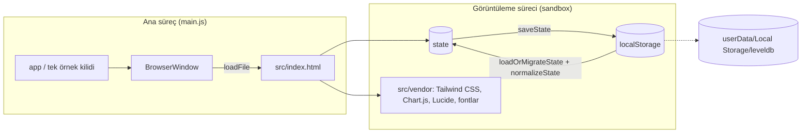
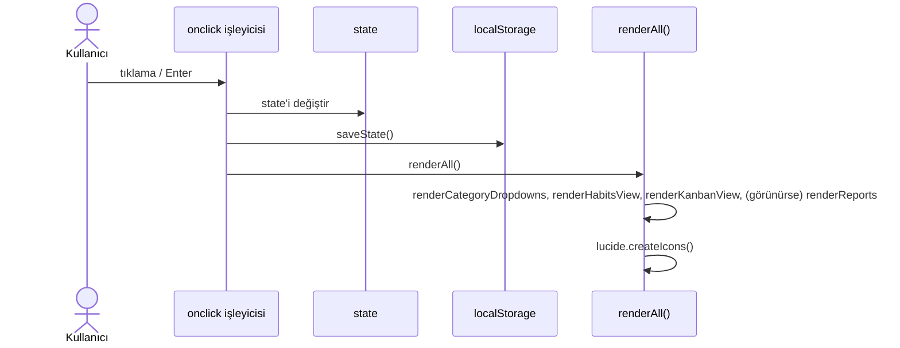

# Cosmos — Teknik Doküman

> İlgili belgeler: [Proje Planı](PROJE_PLANI.md) · [İş Akışları](IS_AKISLARI.md) · [Bilinen Sorunlar](BILINEN_SORUNLAR.md)

## 1. Genel mimari

Cosmos bir **Electron** uygulamasıdır. Uygulamanın tamamı tek bir HTML dosyasında, Vanilla JavaScript ile yazılmıştır. Bundler, framework veya sunucu kullanılmaz.



- **Ana süreç** ([`main.js`](../main.js)): pencereyi açar ve veri klasörünü sabitler. Ayrıca aynı anda tek örnek çalışmasını sağlar, sayfa dışına gezinmeyi ve yeni pencere açmayı engeller.
- **Görüntüleme süreci** ([`src/index.html`](../src/index.html)): tüm arayüz, durum (state) yönetimi ve hesaplamalar burada yapılır. `nodeIntegration: false`, `contextIsolation: true` ve `sandbox: true` ayarlarıyla Node.js'e erişimi yoktur.
- **Ağ erişimi yoktur.** CSP `connect-src 'none'` olarak ayarlı; tüm kaynaklar `src/vendor/` klasöründen yüklenir.

## 2. Dizin yapısı

| Yol | Açıklama |
|---|---|
| `main.js` | Electron ana süreci |
| `src/index.html` | Uygulama: HTML + CSS + JS (~2400 satır) |
| `src/vendor/` | Derlenmiş `tailwind.css`, `chart.umd.min.js`, `lucide.min.js`, `fonts/`. **Commit'lenir.** |
| `src/styles/tailwind.input.css` | Tailwind giriş dosyası |
| `src/assets/icon.png` | Pencere ikonu ve üst çubuk logosu (512 px) |
| `build/icon.png` | electron-builder ikonu (1024 px; `.ico` ve `.icns` bundan üretilir) |
| `Logo/Logo.jpg` | Orijinal logo çalışması |
| `scripts/vendor.js` | `node_modules`'dan `src/vendor`'a kopyalama |
| `scripts/icon.js` | Logodan ikon üretimi |
| `scripts/screenshots.js` | Demo veriyle README ekran görüntüleri |
| `scripts/smoke-test.js` | Uçtan uca duman testi |
| `tailwind.config.js` | Tailwind yapılandırması (`content: src/index.html`) |
| `.github/workflows/build.yml` | CI: test, 3 platform derleme, sürüm yayınlama |
| `docs/` | Kılavuzlar, plan, teknik doküman, ekran görüntüleri |

## 3. Teknoloji yığını ve sürümler

| Bileşen | Sürüm | Not |
|---|---|---|
| Electron | ^30 | Yükseltilmesi planlanıyor (bkz. Bilinen Sorunlar A1) |
| electron-builder | ^24.13 | NSIS, portable, DMG, AppImage, deb |
| Tailwind CSS | 3.4.19 | CLI ile derlenir, çıktı `src/vendor/tailwind.css` |
| Chart.js | 4.5.1 | UMD paketi |
| Lucide | 1.59.0 | UMD paketi; `data-lucide` öznitelikleri `lucide.createIcons()` ile SVG'ye çevrilir |
| Inter, Space Grotesk | Fontsource 5.3 | Değişken (variable) fontlar; latin + latin-ext (Türkçe karakterler için) |

Tüm sürümler `package.json` içinde **sabitlenmiştir**. Bir kütüphaneyi yükseltmek için:

```bash
npm install --save-dev --save-exact chart.js@X.Y.Z
npm run vendor
```

## 4. Veri modeli

Veri, `localStorage` içinde `cosmos_tracker_v2` anahtarıyla tek bir JSON olarak saklanır.

```js
{
  categories: string[],                 // en az 1 eleman
  habits: [{
    id: number | string,
    name: string,
    category: string,
    color: "#RRGGBB",
    scheduledDays: number[],            // 0 = Pazartesi … 6 = Pazar, en az 1 eleman
    history: { "YYYY-MM-DD": true }     // yalnızca tamamlanan günler
  }],
  projects: [{                          // en az 1 eleman
    id: "proj-…",
    name: string,
    color: "#RRGGBB",
    cards: [{
      id: "card-…",
      title: string,
      desc: string,
      status: "todo" | "inprogress" | "done",
      color: "#RRGGBB",
      tags: [{ name: string, color: "#RRGGBB" }],
      checklist: [{ text: string, done: boolean }],
      createdAt: "YYYY-MM-DD"
    }]
  }],
  activeProjectId: string
}
```

**Disk konumu** (`main.js` içinde sabitlenir, ürün adından bağımsızdır):

| Sistem | Klasör |
|---|---|
| Windows | `%APPDATA%\aliskanlik-takip-paneli\` |
| macOS | `~/Library/Application Support/aliskanlik-takip-paneli/` |
| Linux | `~/.config/aliskanlik-takip-paneli/` |

> ⚠️ `package.json` içindeki `"name"` alanı değiştirilmemeli. Ayrıca üst seviyeye `productName` eklenmemeli; Electron bu alanı uygulama adı olarak kullanır.

### Geçiş ve onarım
1. `loadOrMigrateState()` önce v2 anahtarını okur. Yoksa eski `desktop_habits_v1` verisini v2 biçimine dönüştürür. O da yoksa örnek verilerle başlar.
2. `normalizeState()` her açılışta ve her yedek yüklemede çalışır:
   - Eksik dizileri tamamlar ve bozuk kayıtları ayıklar.
   - Geçersiz renkleri varsayılan renge döndürür.
   - En az bir kategori ve bir proje olmasını garanti eder.
   - Bilinmeyen alanları korur; ileride eklenecek alanlar kaybolmaz.

**Kural:** Şema yalnızca geriye uyumlu şekilde genişletilir. Yeni alan eklenince eski kayıtlarda bu alan olmayacağı varsayılır ve `normalizeState()` içinde varsayılan değer verilir.

## 5. Arayüz ve çizim döngüsü



- Arayüz, `innerHTML` ile template string'lerden üretilir. **Kullanıcıdan gelen her metin `esc()` ile kaçışlanmalıdır.**
- Butonlar inline `onclick` ile bağlıdır; bu yüzden fonksiyonlar global kapsamda kalmalıdır.
- Grafikler her çizimde yok edilip (`destroy`) yeniden oluşturulur.
- Tarih anahtarları her zaman `formatDateKey()` ile, yerel saate göre `YYYY-MM-DD` biçiminde üretilir. `isFutureDay()` gelecek günleri oranların dışında tutar.

### Pencereler (modal), uyarılar ve bildirimler

| Fonksiyon | Görev |
|---|---|
| `openModal(id, focusId)` / `closeModal(id)` | Pencereyi açar/kapatır, açık pencere yığınını tutar, yıldız animasyonunu durdurur/başlatır, ilk kutuyu seçer |
| `showDialog(msg, opts)` → `Promise<boolean>` | Uygulama içi uyarı/onay penceresi |
| `uiConfirm(msg, okText)` | Silme gibi tehlikeli işlemler için kırmızı onay |
| `showToast(msg, type)` | Köşede kısa bildirim (`info`, `success`, `error`) |
| `flagInvalid(inputId, msg)` | Zorunlu alanı kırmızı çerçeveyle işaretler, kutuyu seçer, bildirim gösterir |

> ⛔ **`alert()`, `confirm()` ve `prompt()` kullanma.** Electron'da Windows'ta bu pencereler kapandıktan sonra metin kutuları klavye girişi almıyor (bkz. Bilinen Sorunlar D1).

Klavye: `ENTER_ACTIONS` tablosundaki kutularda Enter kaydeder. Esc, en üstteki pencereyi kapatır (`MODAL_CLOSERS`).

### Yıldız animasyonu
`starfield` nesnesi saniyede ~24 kare çizer. Bir pencere açıkken, uygulama arka plandayken veya sistemde "hareketi azalt" açıkken animasyon durur. Bunun nedeni, cam panellerdeki `backdrop-filter` bulanıklığının her karede yeniden hesaplanmasıdır.

## 6. Temel algoritmalar

**Seri (`calculateHabitStreak`)**
- Bugünden geriye en fazla 365 gün tarar.
- Planlanmayan günler atlanır; seriyi bozmaz.
- Bugün henüz işaretlenmemişse dünden itibaren sayılır.

**Haftalık hedef**
- Haftada planlanan günlerden kaçının tamamlandığını gösterir.
- Plan dışı günlerdeki işaretler hedefe sayılmaz.

**Oranlar ve raporlar**
- Bir gün için oran: o gün planlanan alışkanlıklardan tamamlananların yüzdesidir.
- Gelecek günler `null` olarak tutulur; grafikte boşluk görünür.

**Isı haritası**
- Son 364 günü gösterir. Her gün, tamamlanma oranına göre 4 renk tonundan biriyle boyanır: `0`, `<0.4`, `<0.8`, `≥0.8`.

## 7. Güvenlik

| Önlem | Yer |
|---|---|
| `contextIsolation`, `sandbox`, `nodeIntegration: false` | `main.js` |
| Tek örnek kilidi (`requestSingleInstanceLock`) | `main.js` |
| `will-navigate` engeli ve `setWindowOpenHandler → deny` | `main.js` |
| Content-Security-Policy (`default-src 'self'`, `connect-src 'none'`) | `index.html` `<head>` |
| HTML kaçışlama (`esc`) ve renk doğrulama (`safeColor`, `HEX_RE`) | `index.html` |

## 8. Derleme ve dağıtım

| Komut | Çıktı (`dist/`) |
|---|---|
| `npm run build:win` | `Cosmos-X.Y.Z-setup.exe`, `Cosmos-X.Y.Z-portable.exe` |
| `npm run build:mac` | `Cosmos-X.Y.Z-mac-x64.dmg`, `Cosmos-X.Y.Z-mac-arm64.dmg` (macOS'ta) |
| `npm run build:linux` | `Cosmos-X.Y.Z-linux-x86_64.AppImage`, `Cosmos-X.Y.Z-linux-amd64.deb` (Linux'ta) |

Her `build:*` komutu önce `build:css` çalıştırır. Kod imzalama henüz yok: macOS'ta `identity: null`, CI'da `CSC_IDENTITY_AUTO_DISCOVERY=false`.

**CI** (`.github/workflows/build.yml`):
- `main`'e her push'ta ve her PR'da çalışır.
- Windows'ta `npm test` çalıştırır.
- Üç platformu derler ve çıktıları "artifact" olarak saklar.
- `v*` etiketi gönderilince dosyaları GitHub Release'e ekler.

## 9. Test

```bash
npm test
```

[`scripts/smoke-test.js`](../scripts/smoke-test.js) uygulamayı ekranda göstermeden (offscreen) açar ve **gerçek klavye olaylarıyla** 34 kontrol yapar:
- proje ve kart oluşturma (iki kez), boş alan uyarısı ve ardından yazabilme
- uygulama içi silme onayı, Enter/Esc davranışı
- geçersiz renk, HTML/tırnak içeren isimler
- eksik ve bozuk yedek yükleme
- gelecek günlerin raporlarda boş bırakılması, kayıt ve konsol hataları

Test geçici bir veri klasörü kullanır; gerçek verilere dokunmaz.

## 10. Kod kuralları

- Arayüz dili Türkçe; kod ve yorumlar İngilizce.
- Yeni Tailwind sınıfı ekledikten sonra `npm run build:css` çalıştır ve `src/vendor/tailwind.css`'i commit'le. Sınıf adlarını parçalardan birleştirme (ör. `bg-${renk}-500`); Tailwind CLI bunları bulamaz.
- CDN kullanma. Yeni kütüphane eklemek için:
  1. devDependency olarak, sabit sürümle kur.
  2. `scripts/vendor.js`'e ekle.
  3. `package.json` içindeki `build.files` listesine ekle.
- Yeni ikon adının `require('lucide').icons` içinde olduğunu doğrula.
- Arayüz değişince `npm run screenshots` ile ekran görüntülerini, gerekirse README ve kılavuzları güncelle.
- Her değişiklikten sonra `npm test` çalıştır; davranış değiştiyse teste kontrol ekle.
